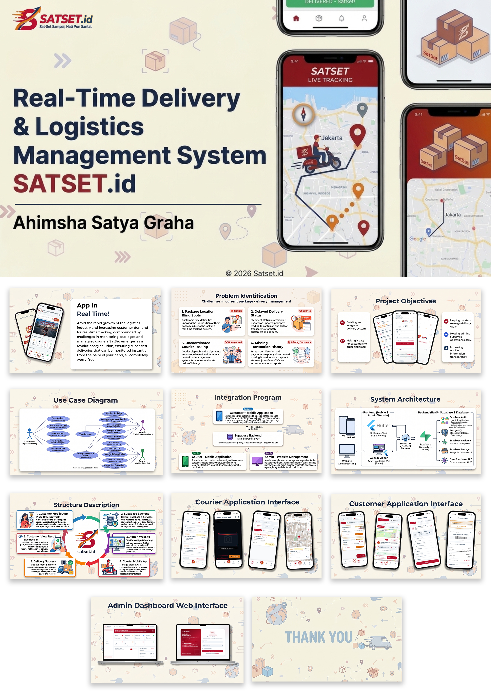

# SatSet

**Real-Time Delivery & Logistics Management System**



SatSet merupakan aplikasi pengiriman barang berbasis mobile yang dikembangkan menggunakan Flutter dan Supabase. Aplikasi ini dirancang untuk mengintegrasikan proses pengiriman barang mulai dari pemesanan oleh pelanggan, pengelolaan tugas kurir, pemantauan lokasi pengiriman secara real-time, hingga pengelolaan operasional melalui website administrator.

Sistem SatSet memiliki tiga jenis pengguna utama, yaitu Customer, Courier, dan Admin. Customer dan Courier menggunakan aplikasi mobile Flutter, sedangkan Admin menggunakan website untuk mengelola dan memantau seluruh aktivitas operasional pengiriman.

---

## Table of Contents

- [Project Overview](#project-overview)
- [Main Features](#main-features)
- [User Roles](#user-roles)
- [Technology Stack](#technology-stack)
- [System Architecture](#system-architecture)
- [Database Design](#database-design)
- [Project Structure](#project-structure)
- [Requirements](#requirements)
- [Installation](#installation)
- [Supabase Configuration](#supabase-configuration)
- [Environment Configuration](#environment-configuration)
- [Running the Application](#running-the-application)
- [Building the Application](#building-the-application)
- [Security](#security)
- [Development Workflow](#development-workflow)
- [Troubleshooting](#troubleshooting)
- [Future Development](#future-development)
- [Contributing](#contributing)
- [References](#references)

---

## Project Overview

SatSet dikembangkan untuk membantu proses pengiriman barang menjadi lebih terstruktur, transparan, dan mudah dipantau. Melalui aplikasi ini, pelanggan dapat melakukan pemesanan pengiriman, menentukan alamat pengirim dan penerima, memilih jenis layanan, melakukan pembayaran, serta memantau perjalanan paket. Kurir dapat menerima tugas pengiriman, melakukan pemindaian barcode, memperbarui status paket, mengirimkan lokasi GPS, dan mengunggah bukti pengiriman. Administrator dapat mengelola data pengiriman, pelanggan, kurir, pembayaran, jenis layanan, laporan, dan pengaturan sistem melalui website admin.

### Project Objectives

- Membangun sistem pengiriman barang yang terintegrasi.
- Mempermudah pelanggan dalam melakukan pemesanan pengiriman.
- Menyediakan informasi posisi paket secara real-time.
- Mempermudah pengelolaan tugas dan aktivitas kurir.
- Menyediakan pengelolaan operasional melalui website administrator.
- Mengintegrasikan transaksi pembayaran dengan proses pengiriman.
- Menyimpan riwayat aktivitas pengiriman secara terstruktur.

---

## Main Features

### 1. Customer Application

Aplikasi Customer digunakan oleh pelanggan untuk melakukan pemesanan dan memantau pengiriman barang.

| Feature | Description |
|---|---|
| Authentication | Registrasi, login, verifikasi email, dan reset password. |
| Dashboard | Menampilkan ringkasan aktivitas dan informasi pengiriman. |
| Order Shipment | Membuat pesanan pengiriman barang. |
| Address Management | Mengelola alamat pengirim dan penerima. |
| Service Selection | Memilih jenis layanan pengiriman. |
| Payment | Mendukung pembayaran transfer melalui payment gateway dan COD. |
| Live Tracking | Memantau lokasi kurir dan status perjalanan paket. |
| Shipment History | Melihat daftar dan riwayat pengiriman. |
| Notifications | Menerima informasi perubahan status dan transaksi. |
| Account Management | Mengelola profil dan informasi akun. |

### 2. Courier Application

Aplikasi Courier digunakan oleh kurir untuk mengelola dan menyelesaikan tugas pengiriman.

| Feature | Description |
|---|---|
| Courier Authentication | Login dan autentikasi akun kurir. |
| Tasks | Melihat daftar tugas pengiriman yang ditugaskan. |
| Barcode Scanner | Memindai barcode untuk mengidentifikasi paket. |
| Task Status | Memperbarui status pengiriman sesuai alur yang diizinkan. |
| Location Tracking | Mengirimkan koordinat GPS selama tugas aktif yang memerlukan tracking. |
| Delivery Proof | Mengunggah bukti penyelesaian pengiriman. |
| Task History | Melihat riwayat tugas pengiriman. |
| Notifications | Menerima pemberitahuan tugas dan aktivitas pengiriman. |

### 3. Admin Website

Website Admin digunakan untuk mengelola dan memantau seluruh kegiatan operasional SatSet Delivery.

| Feature | Description |
|---|---|
| Dashboard | Menampilkan ringkasan statistik operasional. |
| Delivery | Mengelola pesanan dan proses pengiriman. |
| Customer Management | Mengelola informasi pelanggan. |
| Courier Management | Mengelola data dan penugasan kurir. |
| Payment | Mengelola dan memantau transaksi pembayaran. |
| Service Types | Mengelola jenis layanan pengiriman. |
| Report | Menampilkan laporan operasional dan transaksi. |
| Settings | Mengelola pengaturan sistem dan akun administrator. |

> Catatan: Website Admin merupakan bagian terpisah dari aplikasi mobile Flutter.

---

## User Roles

SatSet Delivery memiliki tiga kategori pengguna:

| Role | Platform | Responsibilities |
|---|---|---|
| Customer | Flutter Mobile | Membuat pesanan dan memantau pengiriman. |
| Courier | Flutter Mobile | Mengelola tugas dan melakukan pengiriman. |
| Admin | Web Application | Mengelola data dan operasional sistem. |

Pembagian data pengguna dilakukan melalui tabel profil masing-masing, yaitu `m_users` untuk Customer dan `m_employee` untuk Admin serta Courier.

---

## Technology Stack

Teknologi yang digunakan dalam pengembangan SatSet:

| Technology | Usage |
|---|---|
| Flutter | Framework aplikasi mobile. |
| Dart | Bahasa pemrograman Flutter. |
| Supabase | Backend as a Service (BaaS). |
| PostgreSQL | Relational Database Management System. |
| Supabase Auth | Autentikasi dan manajemen akun. |
| Supabase Realtime | Pembaruan data secara real-time. |
| Supabase Storage | Penyimpanan file dan bukti pengiriman. |
| Supabase Edge Functions | Backend untuk proses bisnis tertentu. |
| PostgreSQL RPC | Eksekusi proses database yang tervalidasi. |
| GPS / Location Services | Mendapatkan koordinat lokasi kurir. |
| Barcode Scanner | Identifikasi paket melalui barcode. |
| Payment Gateway | Integrasi pembayaran digital. |

---

## System Architecture

Arsitektur sistem SatSet terdiri dari tiga komponen utama.

### Mobile Application

Dikembangkan menggunakan Flutter dan digunakan oleh Customer serta Courier. Aplikasi berkomunikasi dengan Supabase untuk autentikasi, pengambilan data, penyimpanan data, dan pembaruan informasi.

### Admin Website

Website terpisah yang digunakan administrator untuk mengelola data pelanggan, kurir, pengiriman, pembayaran, dan laporan.

### Backend Infrastructure

Supabase digunakan sebagai infrastruktur backend yang menyediakan:

- Authentication untuk autentikasi pengguna.
- PostgreSQL untuk penyimpanan data.
- Realtime untuk sinkronisasi data.
- Storage untuk penyimpanan bukti pengiriman.
- Edge Functions dan RPC untuk validasi proses bisnis.

---

## Database Design

Database SatSet Delivery menggunakan PostgreSQL pada Supabase dengan struktur tabel master data dan transaksi.

### Master Data Tables

| Table | Description |
|---|---|
| `m_users` | Data profil pelanggan. |
| `m_employee` | Data administrator dan kurir. |
| `m_users_role` | Referensi jenis role pengguna. |
| `m_provinsi` | Data provinsi. |
| `m_kabkot` | Data kabupaten/kota. |
| `m_kecamatan` | Data kecamatan. |
| `m_kelurahan` | Data kelurahan/desa. |
| `m_address` | Data alamat pelanggan. |
| `m_label` | Referensi label alamat. |
| `m_service_types` | Jenis layanan pengiriman. |
| `m_shipment_statuses` | Referensi status pengiriman. |
| `m_jenis_bank` | Jenis atau kategori bank. |
| `m_bank` | Informasi rekening bank. |

### Transaction Tables

| Table | Description |
|---|---|
| `t_shipments` | Data utama pengiriman. |
| `t_shipment_items` | Detail barang yang dikirim. |
| `t_shipment_assignments` | Penugasan kurir. |
| `t_shipment_tracking` | Riwayat status pengiriman. |
| `t_shipment_locations` | Riwayat lokasi GPS kurir. |
| `t_shipment_proofs` | Bukti penyelesaian pengiriman. |
| `t_barcode_scans` | Riwayat pemindaian barcode. |
| `t_notifications` | Notifikasi pelanggan dan pegawai. |
| `t_shipment_payments` | Data transaksi pembayaran. |

### Database Relationships

Relasi utama database meliputi:

- Customer memiliki beberapa alamat.
- Customer dapat membuat beberapa pesanan pengiriman.
- Setiap pengiriman menggunakan jenis layanan dan status tertentu.
- Setiap pengiriman dapat memiliki beberapa detail barang.
- Pengiriman dapat memiliki riwayat penugasan kurir.
- Pengiriman memiliki riwayat perubahan status.
- Kurir dapat mengirimkan beberapa catatan lokasi GPS.
- Pengiriman dapat memiliki bukti pengiriman.
- Pengiriman dapat memiliki catatan pemindaian barcode.
- Pengiriman memiliki data transaksi pembayaran.
- Customer dan pegawai dapat menerima notifikasi.

---

## Project Structure

Contoh struktur direktori aplikasi Flutter:

```text
satset/
│
├── android/
├── ios/
├── web/
├── assets/
│
├── lib/
│   │
│   ├── app/
│   │   ├── config/
│   │   ├── constants/
│   │   └── observers/
│   │
│   ├── core/
│   │   ├── error/
│   │   ├── network/
│   │   ├── services/
│   │   └── usecases/
│   │
│   ├── features/
│   │   ├── account/
│   │   ├── add/
│   │   ├── auth/
│   │   │
│   │   ├── admin/
│   │   │   ├── admin_courier/
│   │   │   ├── admin_customer/
│   │   │   ├── auth/
│   │   │   ├── dashboard/
│   │   │   ├── delivery/
│   │   │   ├── jenis_layanan/
│   │   │   ├── navbar/
│   │   │   ├── payment/
│   │   │   ├── report/
│   │   │   ├── settings/
│   │   │   └── utils/
│   │   │
│   │   ├── courier/
│   │   │   ├── barcode_scanner/
│   │   │   ├── delivery_proof/
│   │   │   ├── location_tracking/
│   │   │   ├── notifications/
│   │   │   ├── tasks/
│   │   │   ├── tasks_history/
│   │   │   └── tasks_status/
│   │   │
│   │   ├── customer/
│   │   │   ├── address/
│   │   │   ├── dashboard/
│   │   │   ├── livetrack/
│   │   │   ├── order/
│   │   │   └── shipments/
│   │   │
│   │   ├── main_navigation/
│   │   ├── notifications/
│   │   └── splash/
│   │
│   ├── shared/
│   │   ├── navigation/
│   │   ├── theme/
│   │   ├── utils/
│   │   └── widgets/
│   │
│   └── main.dart
│
├── test/
│
├── pubspec.yaml
├── analysis_options.yaml
├── .gitignore
└── README.md
```

> Struktur di atas merupakan referensi arsitektur modular. Sesuaikan dengan struktur direktori aktual repository.

---

## Requirements

Pastikan perangkat pengembangan sudah memiliki:

- Flutter SDK.
- Dart SDK (sesuai versi Flutter).
- Android Studio atau Visual Studio Code.
- Android SDK atau emulator.
- Git.
- Akun Supabase.
- Project Supabase yang telah dikonfigurasi.

Periksa instalasi Flutter:

```bash
flutter doctor
```

Periksa versi Flutter:

```bash
flutter --version
```

Periksa versi Dart:

```bash
dart --version
```

---

## Installation

### 1. Clone Repository

Clone repository SatSet Delivery dari GitHub.

```bash
git clone https://github.com/USERNAME/satset.git
```

Masuk ke direktori project:

```bash
cd satset
```

Ganti `USERNAME` dengan username GitHub pemilik repository.

### 2. Install Dependencies

Jalankan perintah berikut untuk mengunduh seluruh dependencies:

```bash
flutter pub get
```

### 3. Configure Supabase

Buat project Supabase melalui:

https://supabase.com/

Siapkan informasi berikut:

- Supabase Project URL.
- Supabase Publishable Key atau anon key sesuai konfigurasi project.

### 4. Configure Environment

Sesuaikan konfigurasi Supabase dengan project yang digunakan.

Contoh konfigurasi menggunakan `--dart-define`:

```bash
flutter run \
  --dart-define=SUPABASE_URL=YOUR_SUPABASE_URL \
  --dart-define=SUPABASE_ANON_KEY=YOUR_SUPABASE_PUBLISHABLE_KEY
```

Pastikan aplikasi membaca konfigurasi tersebut pada proses inisialisasi Supabase.

Contoh inisialisasi:

```dart
await Supabase.initialize(
  url: const String.fromEnvironment('SUPABASE_URL'),
  anonKey: const String.fromEnvironment('SUPABASE_ANON_KEY'),
);
```

Jangan memasukkan service-role key atau secret key ke dalam aplikasi Flutter.

### 5. Run Application

Setelah konfigurasi selesai, jalankan:

```bash
flutter run
```

---

## Supabase Configuration

Supabase berfungsi sebagai backend utama SatSet.

### Authentication

Supabase Auth digunakan untuk:

- Registrasi akun.
- Login.
- Verifikasi email.
- Reset password.
- Pengelolaan sesi autentikasi.

Profil Customer disimpan pada `m_users`, sedangkan profil Admin dan Courier disimpan pada `m_employee`.

### Database

Database PostgreSQL menyimpan informasi pelanggan, pegawai, wilayah, layanan, pengiriman, penugasan kurir, tracking, pembayaran, dan notifikasi. Pastikan seluruh tabel, Primary Key, Foreign Key, Unique Constraint, serta indeks sudah dikonfigurasi sesuai ERD.

### Row Level Security (RLS)

Aktifkan RLS pada tabel yang menyimpan data pengguna dan transaksi.

Contoh pembatasan akses:

- Customer hanya dapat mengakses data yang menjadi haknya.
- Courier hanya dapat mengakses tugas yang ditugaskan kepadanya.
- Admin dapat mengakses data operasional sesuai kewenangannya.

### Realtime

Supabase Realtime digunakan untuk mendukung:

- Pembaruan status pengiriman.
- Perubahan informasi tracking.
- Pembaruan lokasi kurir.
- Notifikasi.
- Informasi transaksi yang relevan.

### Storage

Supabase Storage digunakan untuk menyimpan file bukti pengiriman dan dokumen terkait sesuai kebutuhan aplikasi. Gunakan bucket dan Storage Policy yang aman. File tidak boleh otomatis dapat diakses publik jika berisi informasi pribadi.

---

## Running the Application

### Run on Android Emulator

```bash
flutter run
```

### Run on Chrome

```bash
flutter run -d chrome
```

### Check Available Devices

```bash
flutter devices
```

### Run Static Analysis

```bash
flutter analyze
```

### Run Unit Tests

```bash
flutter test
```

---

## Building the Application

### Build APK

```bash
flutter build apk --release
```

### Build App Bundle

```bash
flutter build appbundle --release
```

### Build Web

```bash
flutter build web --release
```

Hasil build Android dan Web akan disimpan pada direktori `build/`.

---

## Security

Keamanan merupakan bagian penting dalam pengembangan SatSet.

Beberapa penerapan keamanan yang digunakan:

1. **Supabase Authentication**  
   Mengelola autentikasi dan sesi pengguna.

2. **Row Level Security (RLS)**  
   Membatasi akses data berdasarkan identitas dan kewenangan pengguna.

3. **Role-Based Access Control**  
   Memisahkan akses Customer, Courier, dan Admin.

4. **Backend Validation**  
   Memvalidasi perubahan status, penugasan kurir, pembayaran, dan proses sensitif melalui backend atau RPC.

5. **Secure Storage**  
   Menyimpan file bukti pengiriman menggunakan kebijakan akses yang sesuai.

6. **Environment Configuration**  
   Menghindari penyimpanan secret key dan service-role key di dalam source code frontend.

7. **Payment Validation**  
   Memastikan status pembayaran dikonfirmasi melalui mekanisme backend atau webhook payment gateway yang terverifikasi.

---

## Development Workflow

Alur pengembangan aplikasi:

1. Menyiapkan database dan konfigurasi Supabase.
2. Mengembangkan autentikasi Customer dan Courier.
3. Mengembangkan fitur Customer.
4. Mengembangkan fitur Courier.
5. Mengintegrasikan GPS dan Realtime.
6. Mengintegrasikan barcode scanner.
7. Mengintegrasikan pembayaran.
8. Mengembangkan website Admin.
9. Melakukan pengujian integrasi dan keamanan.
10. Melakukan build dan deployment aplikasi.

---

## Troubleshooting

### Flutter Dependencies Error

Jika terjadi masalah dependencies, jalankan:

```bash
flutter clean
flutter pub get
```

### Supabase Connection Error

Periksa kembali:

- Supabase Project URL.
- Publishable Key atau anon key.
- Koneksi internet.
- Status project Supabase.
- Konfigurasi inisialisasi Supabase.

### Authentication Error

Pastikan:

- Email dan password valid.
- Email verification telah diselesaikan jika diwajibkan.
- Konfigurasi Supabase Auth sudah benar.
- Mapping profil pengguna ke Supabase Auth tersedia.

### RLS Permission Error

Periksa:

- Status RLS pada tabel.
- Policy SELECT, INSERT, UPDATE, dan DELETE.
- Identitas pengguna yang sedang login.
- Relasi pemilik data atau penugasan kurir.
- Hak akses berdasarkan role.

### Location Tracking Error

Pastikan:

- Izin lokasi telah diberikan.
- GPS perangkat aktif.
- Aplikasi memiliki izin lokasi yang sesuai.
- Tugas kurir sedang aktif dan membutuhkan tracking.
- Koneksi internet tersedia.

---

## Future Development

Pengembangan selanjutnya dapat mencakup:

- Optimasi performa tracking GPS.
- Pengembangan analitik operasional.
- Peningkatan sistem notifikasi.
- Integrasi payment gateway secara menyeluruh.
- Pengembangan laporan pengiriman yang lebih lengkap.
- Peningkatan pengujian otomatis.
- Pengembangan fitur monitoring operasional.

---

## Contributing

Kontribusi untuk pengembangan SatSet dapat dilakukan melalui tahapan berikut:

1. Fork repository.
2. Buat branch fitur baru.

```bash
git checkout -b feature/nama-fitur
```

3. Lakukan perubahan kode.
4. Jalankan pemeriksaan kode.

```bash
flutter analyze
flutter test
```

5. Commit perubahan.

```bash
git add .
git commit -m "feat: add new feature"
```

6. Push branch ke GitHub.

```bash
git push origin feature/nama-fitur
```

7. Buat Pull Request untuk proses review.

---

## References

Dokumentasi resmi yang digunakan dalam pengembangan:

- [Flutter Documentation](https://docs.flutter.dev/)
- [Flutter Installation](https://docs.flutter.dev/get-started/install)
- [Flutter Learning Resources](https://docs.flutter.dev/reference/learning-resources)
- [Dart Documentation](https://dart.dev/guides)
- [Supabase Documentation](https://supabase.com/docs)
- [Supabase Flutter](https://supabase.com/docs/reference/dart/introduction)
- [Supabase Authentication](https://supabase.com/docs/guides/auth)
- [Supabase Database](https://supabase.com/docs/guides/database)
- [Supabase Realtime](https://supabase.com/docs/guides/realtime)
- [Supabase Storage](https://supabase.com/docs/guides/storage)

---

## License

License for this project has not yet been specified.

---

**SatSet**  
*Smart Logistics. Real-Time Tracking. Better Delivery Experience.*
